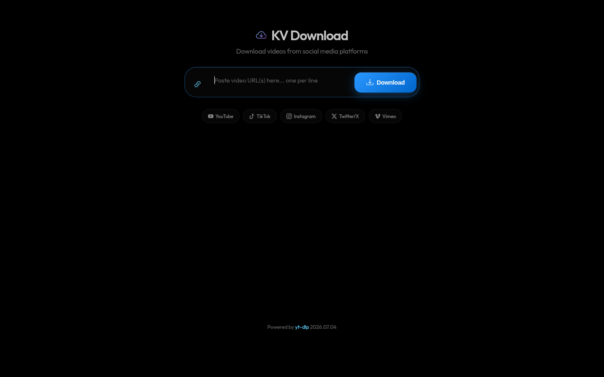

# ⚡ KV-Download — Universal Multi-Platform Media Extractor & Downloader

<div align="center">

**A blazing-fast, mobile-friendly Go + yt-dlp media downloader with batch queuing, ZIP export, and anti-bot browser impersonation.**

[](https://github.com/vndangkhoa/kv-download/stargazers)
[](https://github.com/vndangkhoa/kv-download/network/members)
[](https://go.dev/)
[](https://hub.docker.com/repositories/vndangkhoa)
[](#-docker)
[](https://github.com/yt-dlp/yt-dlp)
[](LICENSE)

[Features](#-key-features) • [Comparison](#-why-kv-download) • [Architecture](#-architecture) • [Quickstart](#-quick-start) • [Docker & NAS](#-docker--nas-deployment) • [API](#-api) • [License](#-license)

</div>

<div align="center">
  
</div>

---

## ⚡ Why KV-Download?

Free online video converters are plagued by intrusive popups, shady redirects, low speed throttles, and privacy risks. Self-hosted alternatives are often bloated, resource-heavy, or fail against aggressive TikTok/Instagram anti-bot mechanisms.

**KV-Download** delivers an ultra-clean, ad-free self-hosted gateway powered by a concurrent **Go HTTP core** and **yt-dlp with `curl_cffi` browser impersonation**.

### 📊 Competitive Matrix

| Feature | ⚡ KV-Download | 🌐 Cobalt | 📺 youtube-dl-webui | 🚫 Ad-filled Converters |
| :--- | :---: | :---: | :---: | :---: |
| **Backend Engine** | **Compiled Go + yt-dlp** | Node.js + custom scrapers | Python / Node | Blackbox / Cloud |
| **Anti-Bot Impersonation**| ✅ **curl_cffi (<0.16) bypass**| ⚠️ API-based | ❌ Basic requests | ❌ Cloudflare block |
| **Multi-URL Batching** | ✅ **Batch paste + ZIP all**| ❌ One-by-one | ⚠️ Queued individually | ❌ One-by-one |
| **Mobile & Glass UI** | ✅ **Responsive Glassmorphism**| ✅ Clean UI | 🐢 Outdated Web UI | 🛑 Cluttered with Ads |
| **Automatic Cookie Refresh**| ✅ **Auto-extract & sync** | ❌ Manual config | ❌ Manual upload | ❌ Not supported |
| **NAS & Homelab Ready** | ✅ **amd64 + arm64 single image**| ⚠️ Heavy multi-container| 🟡 Single arch often | ❌ Cloud only |
| **Zero Telemetry / Ads** | ✅ **100% Private & Open** | ✅ Open source | ✅ Open source | ❌ Malware / Tracking |

---

## ✨ Key Features

| 🚀 Multi-URL Batch | 📥 Concurrent Queue | 💾 Bundle ZIP Export |
| :---: | :---: | :---: |
| Paste multiple URLs at once and download in parallel | Live real-time download progress and status per link | One-click bundle to download all extracted videos as a single `.zip` |

| 📱 Responsive Glassmorphism | 👀 In-Browser Preview | 🔄 Auto-Updating Engine |
| :---: | :---: | :---: |
| Sleek modern dark mode for desktop, tablet, and mobile | Watch videos directly before downloading | yt-dlp automatically refreshes its extractors every 6 hours |

| 🛡️ Anti-Bot Bypass | 🔄 Smart Retries | 🧹 Automated NAS Cleanup |
| :---: | :---: | :---: |
| Browser fingerprint impersonation via `curl_cffi` | Automatic 3× retry on transient network/platform limits | Cron-friendly file expiration for Synology NAS |

**Supported Platforms:** YouTube · TikTok · Instagram · Twitter / X · Facebook · Vimeo · Reddit · Twitch · [and 1000+ more](https://github.com/yt-dlp/yt-dlp/blob/master/supportedsites.md).

---

## 🏗️ Architecture

```
┌────────────────────────────────────────────────────────┐
│             Web Browser / Bookmarklet / API            │
└───────────────────────────┬────────────────────────────┘
                            │ HTTP GET/POST (JSON / Stream)
┌───────────────────────────▼────────────────────────────┐
│                  KV-Download Go Engine                 │
│                                                        │
│  ┌──────────────────────┐    ┌──────────────────────┐  │
│  │   Goroutine Worker   │    │  In-Memory / SQLite  │  │
│  │   Batch Queue Pool   │    │     Job Dispatch     │  │
│  └──────────┬───────────┘    └──────────────────────┘  │
│             │                                          │
│  ┌──────────▼───────────────────────────────────────┐  │
│  │     yt-dlp Engine + curl_cffi Browser TLS        │  │
│  │       (Auto-Cookie Injector + Proxy Support)     │  │
│  └──────────────────────────┬───────────────────────┘  │
└─────────────────────────────┼──────────────────────────┘
                              │ HTTPS with TLS Camouflage
┌─────────────────────────────▼──────────────────────────┐
│     Target Media Platforms (YouTube, TikTok, X...)     │
└────────────────────────────────────────────────────────┘
```

---

## 🚀 Quick Start

**Prerequisites:** [Go 1.24+](https://go.dev/dl/), [yt-dlp](https://github.com/yt-dlp/yt-dlp#installation), [FFmpeg](https://ffmpeg.org/download.html).

```bash
git clone https://github.com/vndangkhoa/kv-download.git
cd kv-download
./run.sh
```

Navigate to **http://localhost:9292** in your browser 🎉

---

## 🐳 Docker & NAS Deployment

### Quick Docker Run

```bash
docker run -d   --name kv-download   -p 9292:9292   -v ./downloads:/download   -v ./cookies.txt:/app/cookies.txt   --restart unless-stopped   vndangkhoa/kv-download:latest
```

### Docker Compose

```yaml
services:
  kv-download:
    image: vndangkhoa/kv-download:latest
    container_name: kv-download
    restart: unless-stopped
    ports:
      - "9292:9292"
    volumes:
      - ./downloads:/download
      - ./cookies.txt:/app/cookies.txt
    environment:
      - TZ=Asia/Ho_Chi_Minh
```

```bash
docker compose up -d
```

### Synology NAS (Container Manager)

1. Open **Container Manager** on DSM.
2. Create project `kv-download` mapped to `/volume1/docker/kv-download/`.
3. Use the Compose snippet above (change volume to `/volume1/docker/kv-download/downloads`).
4. Place `cookies.txt` in `/volume1/docker/kv-download/` if downloading restricted social media clips.
5. Set up DSM **Task Scheduler** for auto-cleanup (e.g., delete files older than 7 days):
   ```bash
   0 3 * * * find /volume1/docker/kv-download/downloads/ -type f -mtime +7 -delete
   ```

---

## 🍪 Cookies & Anti-Bot Bypass

Some platforms (**TikTok**, **Instagram**, **Twitter/X**) require active session cookies to download HD or restricted media.

### Option 1: Built-in Automatic Cookie Sync 🔄

Set `MR_COOKIES_BROWSER` to auto-extract cookies on startup and every 24 hours:

```bash
docker run -d -p 9292:9292   -e MR_COOKIES_BROWSER=chrome   -v ./downloads:/download   vndangkhoa/kv-download:latest
```

### Option 2: Manual `cookies.txt`

1. Use browser extension [Get cookies.txt LOCALLY](https://chromewebstore.google.com/detail/get-cookiestxt-locally/cclelndahbckbenkjhflpdbgdldlbecc) (Chrome) or [cookies.txt](https://addons.mozilla.org/en-US/firefox/addon/cookies-txt/) (Firefox).
2. Export cookies for your target domain.
3. Mount the file into `/app/cookies.txt` in the container.

> ⚠️ **Note:** Mount `cookies.txt` as **read-write** (not `:ro`), as yt-dlp updates cookies on exit.

---

## ⚙️ Environment Configuration

| Variable | Description | Default |
|---|---|---|
| `MR_DOWNLOAD_DIR` | Main folder where downloads are stored (`videos/`, `music/`, `photos/`) | `/download` (Docker) / `downloads/` |
| `MR_PROXY` | HTTP/SOCKS5 proxy URL for geo-blocked downloads | _(empty)_ |
| `MR_COOKIES_BROWSER` | Browser to auto-extract cookies (`chrome`, `firefox`, `edge`, `brave`, `safari`) | _(disabled)_ |
| `MR_COOKIES_URL` | Check URL during cookie refresh | `https://www.tiktok.com/` |
| `MR_COOKIES_MAX_AGE_HOURS` | Expiration limit before refreshing cookies | `168` (7 days) |

---

## 📡 REST API & Bookmarklet

### Fetch Media Info
```http
GET /api/info?url=https://www.youtube.com/watch?v=VIDEO_ID
```
```json
{
  "media": [
    {
      "Id": "abc123/video.mp4",
      "Name": "video.mp4",
      "SizeInBytes": 1048576,
      "HumanSize": "1.0 MB"
    }
  ],
  "error": ""
}
```

### Stream Video
```http
GET /download?id=abc123/video.mp4
```

### Batch ZIP Archive
```http
GET /download/zip?id=ID1&id=ID2&id=ID3
```

### One-Click Browser Bookmarklet
Drag this snippet into your browser bookmarks bar:
```javascript
javascript:(location.href="http://localhost:9292/fetch?url="+encodeURIComponent(location.href));
```

---

## 🌟 Star History

[](https://star-history.com/#vndangkhoa/kv-download&Date)

---

## 📄 License

This project is open source under the [MIT License](LICENSE).

<div align="center">
  
  <br><br>
  <sub>Crafted with ❤️ by <a href="https://github.com/vndangkhoa">vndangkhoa</a></sub>
</div>
